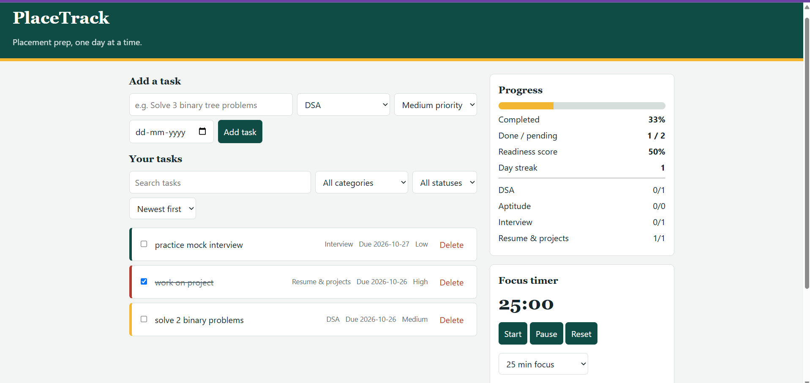
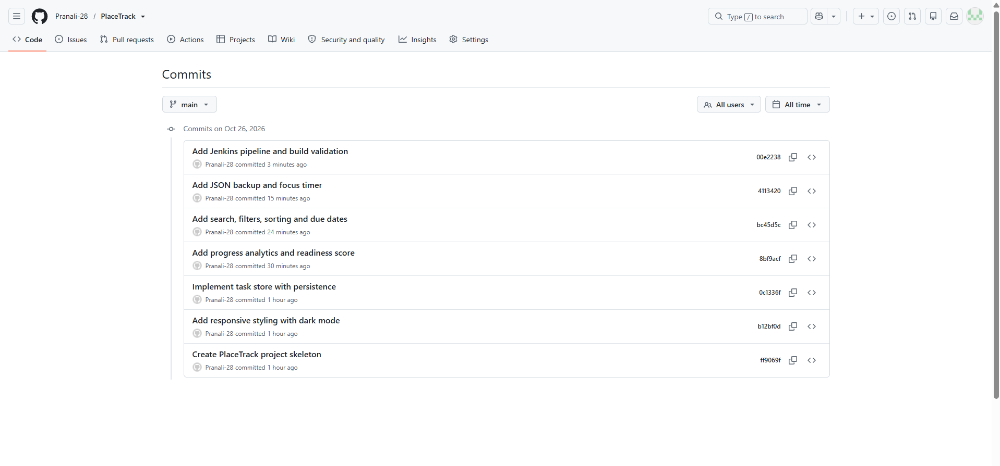
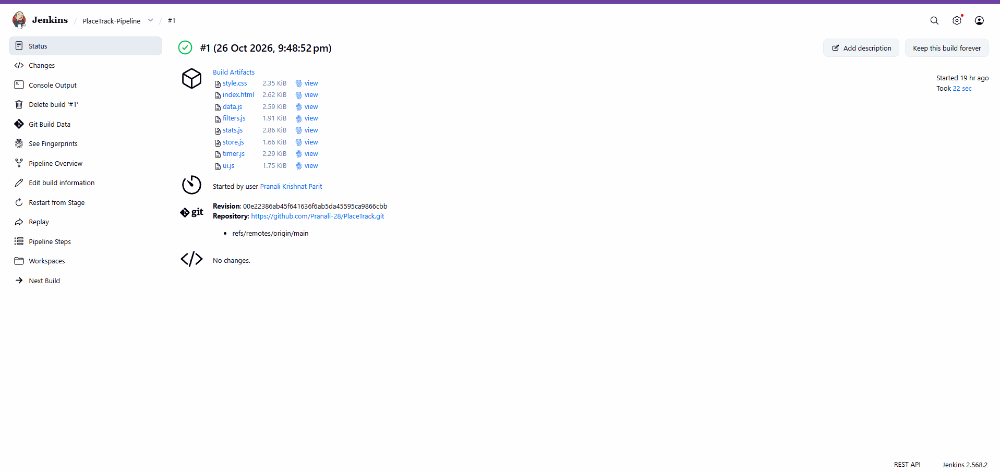
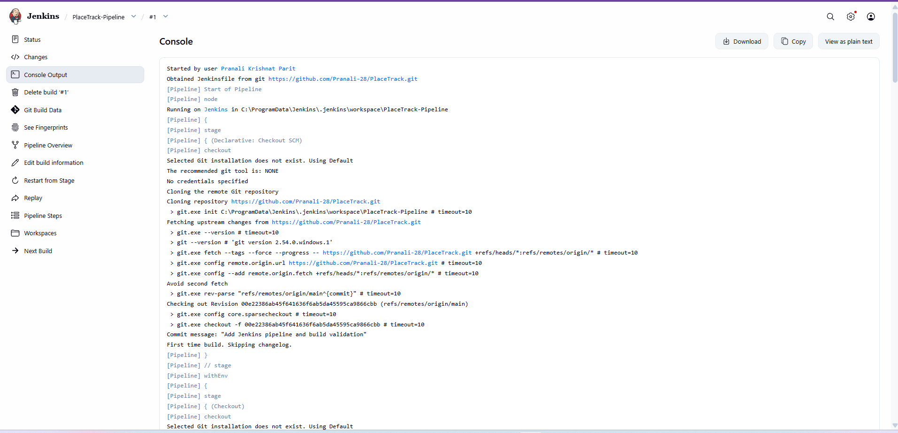

# PlaceTrack – Placement Preparation Tracker

## 1. Introduction and Objective

PlaceTrack is a web-based placement preparation tracker designed to help students organize their placement preparation activities and monitor their progress. It provides a simple interface for managing preparation tasks and tracking progress. This project demonstrates website development, version control using Git and GitHub, and continuous integration using Jenkins.

## 2. Technology Stack

| Component | Technology |
|---|---|
| Frontend | HTML, CSS, JavaScript |
| Version Control | Git |
| Remote Repository | GitHub |
| DevOps Tool | Jenkins |
| Development Environment | Windows |

## 3. Website Preview

PlaceTrack provides an interface for students to manage their placement preparation activities.



*Figure 1: PlaceTrack website interface.*

## 4. Features

- Placement preparation task management.
- Task priorities and progress tracking, if implemented.
- Simple and user-friendly website interface.
- Version control using Git and GitHub.
- Continuous integration using Jenkins.

## 5. How to Run the Website

1. Clone the repository:

   ```bash
   git clone https://github.com/Pranali-28/PlaceTrack.git
   ```

2. Open the downloaded project folder.
3. Open `index.html` in your web browser.

## 6. Changes Made and Git Workflow

Git was used to track project changes, while GitHub was used to host the remote repository.



*Figure 2: Git commit history showing project development.*

### Git Commands Used

```bash
git status
git add .
git commit -m "Update website"
git log --oneline
git push origin main
```

**GitHub Repository:** [PlaceTrack on GitHub](https://github.com/Pranali-28/PlaceTrack)

## 7. Jenkins Integration

Jenkins was used to configure and execute a continuous integration pipeline for the project.

### Steps Followed

1. Created a Pipeline job in Jenkins.
2. Configured the repository and branch, if using Pipeline from SCM.
3. Specified the `Jenkinsfile` path, if configured.
4. Executed the pipeline.
5. Reviewed the build status and console output.

### Jenkins Pipeline Configuration



*Figure 3: Jenkins pipeline configuration.*

### Jenkins Build Results



*Figure 4: Jenkins build results.*

### Pipeline Explanation

Describe the stages actually configured in your `Jenkinsfile`, such as checkout, validation, testing, build, or archiving, if present.

## 8. Conclusion

PlaceTrack demonstrates the development of a placement preparation tracking website and the application of version control and DevOps practices. The project provides practical experience with web development, Git, GitHub, and Jenkins pipeline integration.
